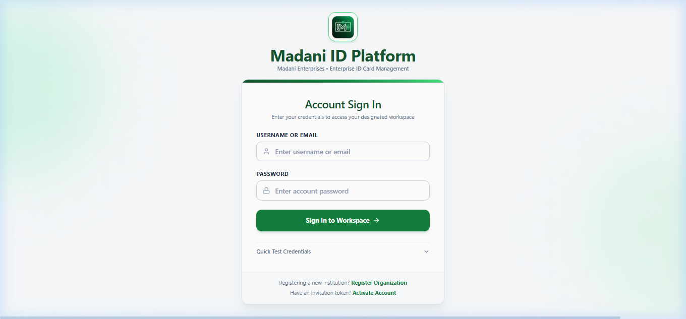
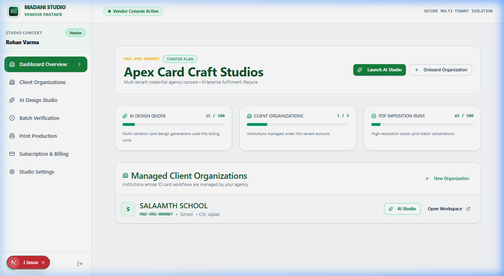
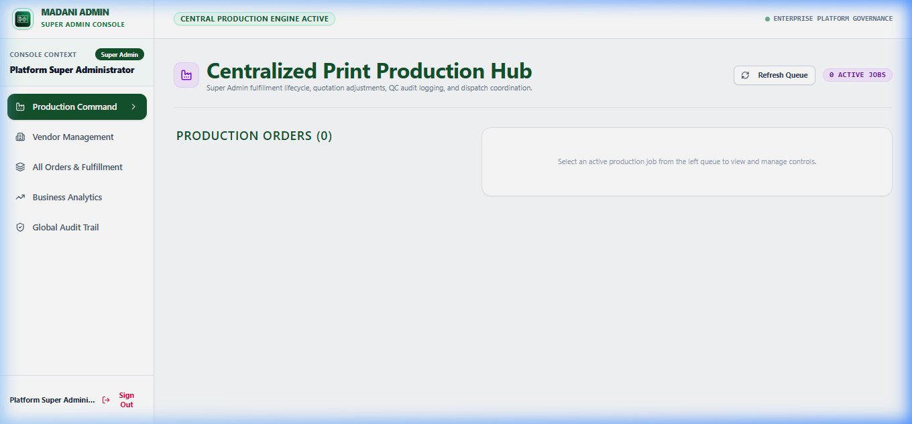
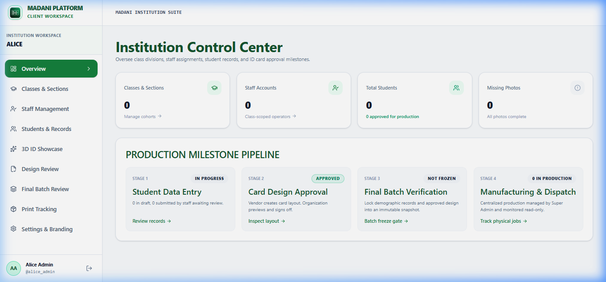
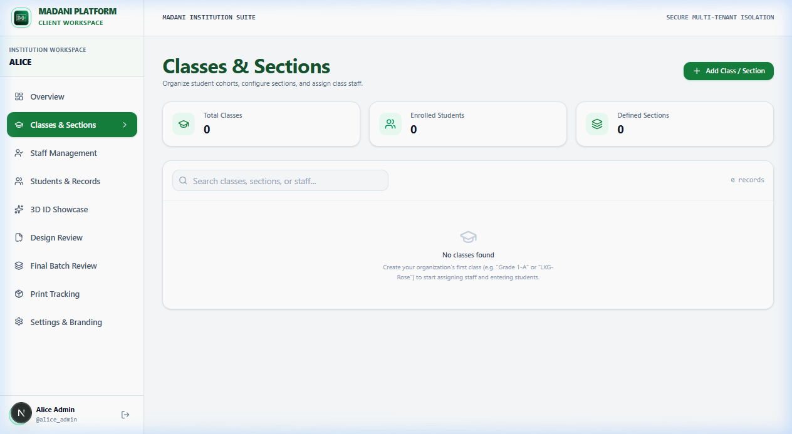
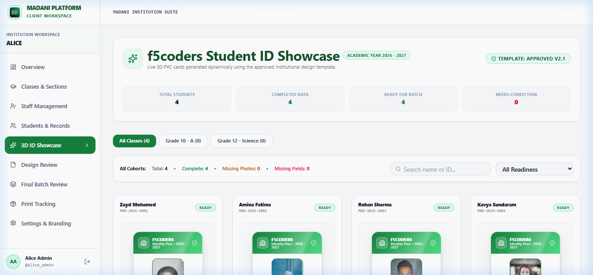
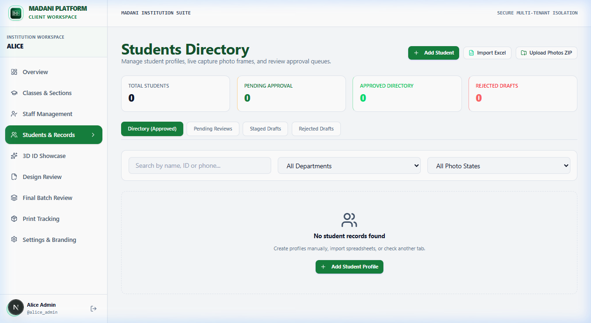

# Madani ID Platform — Enterprise User Manual & Operations Guide


**Version:** 2.0 Enterprise  
**Design Theme:** Emerald Green (`#15803D`, `#14532D`, `#4ADE80`, `#FFFFFF`)  
**Architecture:** Next.js 16 + FastAPI + PostgreSQL Multi-Tenant SaaS  

---

## Table of Contents
1. [Executive Summary & Workflow Overview](#1-executive-summary--workflow-overview)
2. [User Personas & Role Permissions](#2-user-personas--role-permissions)
3. [Unified Authentication & Single Sign-On](#3-unified-authentication--single-sign-on)
4. [Vendor Workflow Guide](#4-vendor-workflow-guide)
   - 4.1 Onboarding Institutions & Brand Setup
   - 4.2 Visual Card Designer & AI Studio
   - 4.3 Production Batch Management & Print Queue
5. [Institution Administrator Workflow Guide](#5-institution-administrator-workflow-guide)
   - 5.1 Classes, Sections & Field Configuration
   - 5.2 Staff Operator Delegation
   - 5.3 Live 3D ID Card Showcase & Card Approval
   - 5.4 Final Batch Review & Imposition Generation
6. [Staff Operator Workflow Guide](#6-staff-operator-workflow-guide)
   - 6.1 Class-Scoped Data Entry
   - 6.2 Student Photo Upload & Cropping
   - 6.3 Card Verification Submission
7. [Super Administrator Governance Guide](#7-super-administrator-governance-guide)
   - 7.1 Multi-Tenant Oversight
   - 7.2 Vendor Management & Global System Metrics
8. [Windows Desktop App & Offline Launcher](#8-windows-desktop-app--offline-launcher)
9. [Prompt to Generate Presentation Deck (PPT)](#9-prompt-to-generate-presentation-deck-ppt)

---

## 1. Executive Summary & Workflow Overview

The **Madani ID Platform** is an enterprise-grade, multi-tenant ID card lifecycle and production engine engineered specifically for educational institutions and identification card manufacturers.

```
+---------------------------------------------------------------------------------------+
|                                END-TO-END BUSINESS LIFECYCLE                          |
+---------------------------------------------------------------------------------------+
|  [Vendor]           1. Onboard school & configure logo / brand standards              |
|                     2. Design front & back ID templates in AI Visual Studio           |
|                                         │                                             |
|                                         ▼                                             |
|  [Institution]      3. Review & approve finalized ID template                         |
|                     4. Configure classes, sections, and assign class staff            |
|                                         │                                             |
|                                         ▼                                             |
|  [Staff Operator]   5. Upload student profiles & crop standard ID photos              |
|                     6. Submit student records for administrative sign-off             |
|                                         │                                             |
|                                         ▼                                             |
|  [Institution]      7. Review records in interactive 3D ID Card Showcase             |
|                     8. Approve records and lock batch for production                  |
|                                         │                                             |
|                                         ▼                                             |
|  [Vendor / Admin]   9. Generate high-res 300 DPI A4 print imposition sheets           |
|                    10. Live production tracking: Queued -> Printing -> Shipped        |
+---------------------------------------------------------------------------------------+
```

---

## 2. User Personas & Role Permissions

| Role | Access Level | Primary Responsibilities |
| :--- | :--- | :--- |
| **Vendor** | Multi-Tenant Provider | Creates ID designs, oversees multiple schools, generates print runs, manages physical production. |
| **Institution Admin** | Tenant Organization | Configures class structure, delegates staff, reviews live 3D ID cards, signs off on production batches. |
| **Staff Operator** | Class-Scoped | Captures student data and photos for assigned classes only; submits cards for review. |
| **Super Admin** | Platform-Wide | System-wide audit logs, server health, vendor provisioning, and global production queue. |

---

## 3. Unified Authentication & Single Sign-On

The Madani ID Platform features a single, centralized authentication portal eliminating overlapping logins or confusion between roles.

- **URL:** `http://localhost:3000/login`
- **Features:**
  - Automated Role Detection: Enter your registered username/email and password; the platform intelligently directs you to your designated portal.
  - Emerald Green Design Theme: High contrast `#15803D` primary actions, `#14532D` typography, and soft neutral surfaces.
  - Fully Responsive: Optimized for desktop monitors, tablets, and mobile smartphones.
  - Standalone Desktop Access: Direct one-click login via `Madani-ID-Platform.exe`.



---

## 4. Vendor Workflow Guide

### 4.1 Onboarding Institutions & Brand Setup
1. Log in with your Vendor credentials.
2. Navigate to **Organizations** from the left navigation bar.
3. Click **Add New Institution**:
   - Enter Institution Legal Name, Code, and Contact Details.
   - Upload official School Crest / Logo and Principal Signature.
   - Designate Institution Administrator Email.
4. An automated activation invitation is dispatched to the school.

### 4.2 Visual Card Designer & AI Studio
1. Open **AI Studio** (`/vendor/ai-studio`) or **Card Designer** (`/organization/designer`).
2. Select Orientation: **Portrait (CR80: 54x86mm)** or **Landscape (CR80: 86x54mm)**.
3. Add Dynamic Placeholders:
   - `{{full_name}}`, `{{member_id}}`, `{{class_name}}`, `{{emergency_contact}}`, `{{qr_code}}`, `{{photo}}`.
4. Configure Front and Back sides with high-resolution background assets, custom typography, and school color palettes.
5. Click **Publish for School Review**.

### 4.3 Production Batch Management & Print Queue
1. Navigate to **Production** (`/admin/production` or `/vendor/production`).
2. Approved batches automatically appear with item count, priority, and institution details.
3. Click **Generate Print Imposition (A4)** or **Download Manifest (CSV)**:
   - Super Admin and Vendor can download 300 DPI high-definition imposition duplex sheets ready for direct PVC printing.
   - Outputs automated crop marks, bleed margins, and front/back duplex alignment.
4. Update tracking status: `QUEUED` -> `PRINTING` -> `LAMINATING` -> `PACKED` -> `SHIPPED`.





---

## 5. Institution Administrator Workflow Guide

### 5.1 Institution Control Center & Hierarchy Management
1. Log in to the **Institution Portal** (`/organization`).
2. The Control Center presents an executive overview of active students, verified records, staff members, and class distribution.
3. Navigate to **Classes & Sections** (`/organization/classes`).
4. Click **Add Class** (e.g., *Grade 10 - Section A*).
5. Define custom fields required on ID cards (e.g., Blood Group, House, Transport Route).





### 5.2 Staff Operator Delegation
1. Navigate to **Staff Accounts** (`/organization/staff`).
2. Click **Invite Staff Operator**.
3. Specify Operator Name, Email, and **Assigned Class Scope** (e.g., restricted to Grade 10-A).
4. Staff can only view and edit records within their assigned class scope.

### 5.3 Live 3D ID Card Showcase & Card Approval
1. Navigate to **Students** (`/organization/students`) or directly open the **3D Showcase** (`/organization/showcase`).
2. Switch between **Table View** and **Interactive 3D ID Card Showcase**:
   - Cards render interactively in 3D canvas with real-time dynamic student photo, barcode, QR code, and holographic overlay.
   - Click **Flip Card** to inspect the reverse side with emergency contacts and school policies.
   - Smooth card carousel enables one-click inspection across all students.
3. Action approvals:
   - **Approve Card**: Moves card to production-ready status.
   - **Request Correction**: Adds a note explaining required fixes (e.g., "Photo blurry, please re-upload").





### 5.4 Final Batch Review & Imposition Generation
1. Navigate to **Batch Review** (`/organization/batch-review`).
2. Review overall student counts, verification statistics, and photo completeness.
3. Click **Final Sign-Off & Lock Batch**.
4. The batch is instantaneously dispatched to the Vendor production queue.

---

## 6. Staff Operator Workflow Guide

1. Log in via `/login` with Staff credentials.
2. The portal strictly displays students from your assigned class.
3. **Adding a Student**:
   - Enter Full Name, Admission Number, Date of Birth, Blood Group, and Parent Phone.
   - Upload Passport Photo: The built-in face detector and cropper automatically centers the portrait.
4. Click **Submit for Administrative Verification**.
5. Real-time feedback badges indicate whether the card is *Under Review*, *Approved*, or *Changes Requested*.

---

## 7. Super Administrator Governance Guide

1. Log in at `/login` with Super Admin credentials.
2. Dashboard provides a system-wide view:
   - Total Tenants, Total Students Registered, Active Print Runs.
   - Multi-tenant data isolation status and audit logs.
   - Vendor performance metrics and SLA tracking.

---

## 8. Windows Desktop App & Offline Launcher

For front-desk operators and production floor workstations, the platform includes a native Windows desktop executable:

- **Executable File:** `Madani-ID-Platform.exe` (Root folder)
- **Batch Launcher:** `Madani-ID-Platform.bat`
- **Behavior:**
  - Automatically initializes local backend services.
  - Launches an isolated, hardware-accelerated application window with custom Madani branding.
  - Zero external dependencies required.

---

## 9. Prompt to Generate Presentation Deck (PPT)

Copy and paste the prompt below into **ChatGPT, Gamma App, Beautiful.ai, or Microsoft Copilot** to instantly generate a professional, high-impact PowerPoint pitch deck and user guide presentation:

```markdown
Generate a 12-slide executive presentation and user guide PowerPoint deck for "Madani ID Platform" — an enterprise-grade multi-tenant ID card issuance and production system.

Brand Identity & Visual Style:
- Color Palette: Emerald Green (#15803D), Dark Pine (#14532D), Mint Accent (#4ADE80), Pure White (#FFFFFF), and Clean Slate Gray (#F8FAFC).
- Aesthetic: Modern SaaS, clean enterprise cards, high contrast, zero clutter, professional typography (Inter / Outfit).

Slide-by-Slide Outline:

Slide 1: Title & Vision
- Title: Madani ID Platform
- Subtitle: Next-Generation Enterprise ID Card Issuance & Production Engine
- Details: Multi-tenant architecture | Real-Time 3D Card Showcase | 300 DPI Print Automation

Slide 2: The Problem in School ID Production
- Manual photo collection via WhatsApp/Email leading to lost files.
- Misaligned print margins and incorrect blood group/name typos.
- Lack of school sign-off leading to expensive re-prints.

Slide 3: The Madani End-to-End Solution
- Visual 5-step lifecycle diagram:
  1. Vendor Brand Setup & AI Studio Design
  2. School Class & Staff Delegation
  3. Class-Scoped Student Data Capture
  4. Interactive 3D Card Showcase & School Approval
  5. One-Click 300 DPI A4 Imposition & Factory Print Tracking

Slide 4: Unified Single Sign-On Architecture
- Role-based intelligent routing through a single secure portal.
- Multi-tenant database isolation ensuring student data privacy.
- Native Windows Desktop App (`Madani-ID-Platform.exe`) for factory workstations.

Slide 5: Persona 1 — Vendor Command Center
- Multi-school portfolio dashboard.
- Drag-and-drop CR80 ID Card Designer with front & back duplex canvas.
- Dynamic placeholders ({{name}}, {{photo}}, {{barcode}}, {{qr_code}}).

Slide 6: Persona 2 — Institution Administrator
- Class & Section hierarchy management.
- Granular Staff Operator account delegation.
- Production batch sign-off and digital audit trail.

Slide 7: Persona 3 — Class-Scoped Staff Operator
- Rapid student data intake and bulk Excel/CSV import.
- Integrated AI portrait centering and automated background cleanup.
- Instant submission for administrative verification.

Slide 8: Highlight Feature — Interactive 3D ID Card Showcase
- Photorealistic CR80 card rendering with holographic overlay.
- Real-time 3D rotation and duplex flip preview.
- Eliminates physical proofing delays and cuts approval time by 80%.

Slide 9: Production & Print Automation
- Automated 8-up and 10-up A4 imposition with dynamic crop marks.
- 300 DPI ultra-high-definition output ready for direct PVC thermal printers.
- Real-time production status stages: Queued -> Printing -> Laminating -> Shipped.

Slide 10: Enterprise Security & Compliance
- Role-Based Access Control (RBAC).
- Encrypted student personally identifiable information (PII).
- Complete tamper-evident audit logs.

Slide 11: Deployment & System Requirements
- Cloud Web Portal (Next.js 16 + FastAPI + PostgreSQL).
- Standalone Windows Desktop Client with offline cache capability.
- Compatible with all standard PVC card printers (Zebra, Evolis, Fargo).

Slide 12: Summary & Next Steps
- Accelerated onboarding timeline (Ready in under 24 hours).
- Contact & Technical Support details.
```
