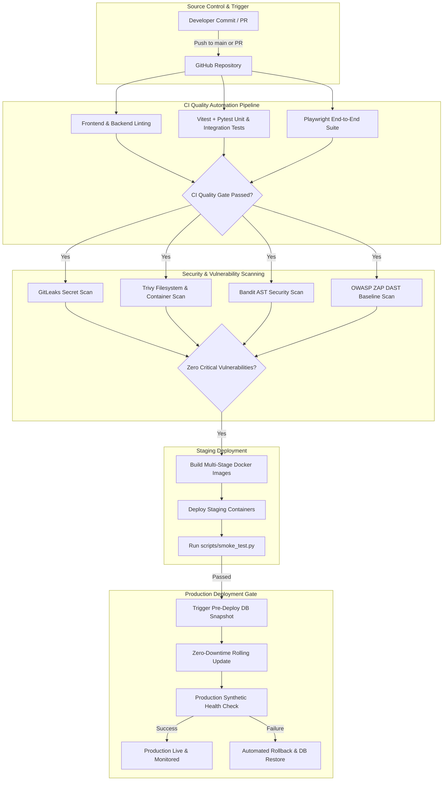

# DevOps Architecture & Automation Pipeline

## 1. System Topology & Pipeline Flow

---

## 2. Environments Matrix

| Environment | Purpose | Ingress URL | Database | Scaling / Isolation |
| :--- | :--- | :--- | :--- | :--- |
| **Development** | Local iteration & testing | `http://localhost:3000` `http://127.0.0.1:8000` | Local PostgreSQL 15 | Standalone processes / Docker Compose |
| **Staging** | Automated QA & smoke tests | `https://staging.madani-id.internal` | Dedicated staging DB | Isolated bridge network `madani_prod_net` |
| **Production** | Live tenant operations | `https://app.madani-id.com` | Production HA cluster | Zero exposed DB ports, multi-replica ASGI |

---

## 3. GitHub Actions CI/CD Workflows

### 1. `ci.yml` (Continuous Integration)
* **Triggers**: Push to `main`, `master`, and Pull Requests.
* **Jobs**:
  * `backend-qa`: Python 3.12, strict Flake8 linting, Pytest (17 integration tests), transaction rollback verification.
  * `frontend-qa`: Node.js 20, strict ESLint flat config, TypeScript compile check (`tsc --noEmit`), Vitest suite (7 unit tests).
  * `e2e-qa`: Chromium headless browser, Playwright end-to-end user journeys (9 UI tests).

### 2. `security.yml` (Security & Vulnerability Scanning)
* **Triggers**: Push to `main`, PRs, and weekly scheduled scan (Mondays at 04:00 UTC).
* **Jobs**:
  * `secret-scan`: GitLeaks scan detecting hardcoded API keys or high-entropy credentials.
  * `dependency-scan`: Trivy scanning dependencies for CRITICAL/HIGH CVEs with SARIF upload.
  * `container-security-scan`: Trivy scanning built Docker container layers.
  * `bandit-sast`: Python AST vulnerability inspection.
  * `owasp-zap-scan`: Automated DAST baseline scanning against `/health` and API routes.

### 3. `performance.yml` (Performance & Load SLA)
* **Triggers**: Manual dispatch and weekly schedule (Sundays at 00:00 UTC).
* **Jobs**:
  * `k6-load-test`: Automated traffic simulation verifying `p95 < 500ms` and `error_rate < 1%`.

### 4. `deploy.yml` (Staging & Production Release)
* **Triggers**: Push to `main` and manual dispatch.
* **Jobs**:
  * `deploy-staging`: Image build, deployment, and automated smoke testing (`scripts/smoke_test.py`).
  * `deploy-production`: Requires staging success, automated pre-deploy PostgreSQL snapshot, zero-downtime rolling update, and synthetic verification with automated rollback.

---

## 4. Branching Strategy & Release Lifecycle
* **`main`**: Protected branch representing deployment-ready code. Direct commits require passing CI checks.
* **Feature Branches (`feat/...`, `fix/...`)**: Developers create isolated feature branches and open Pull Requests.
* **Release Tags (`vX.Y.Z`)**: Semantic versioning tags generate automated container releases and changelog manifests.
